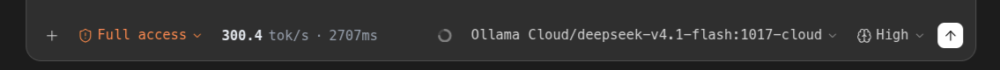
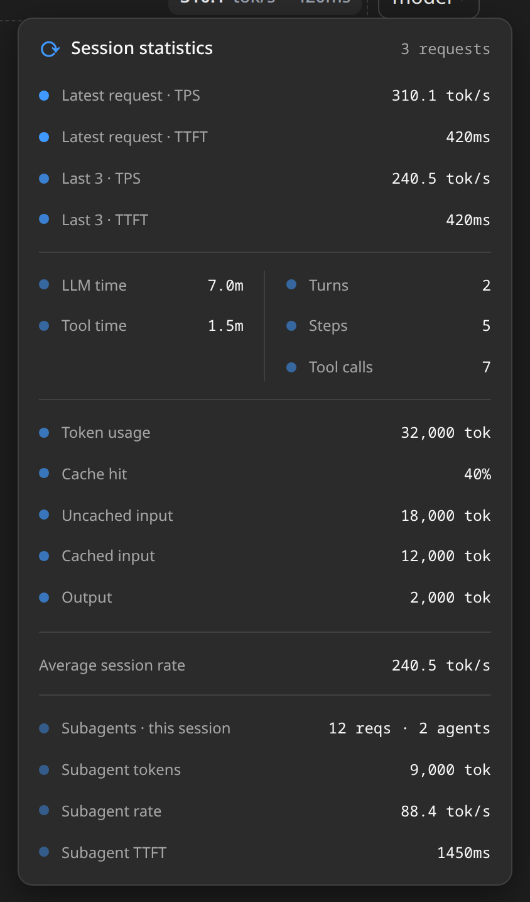
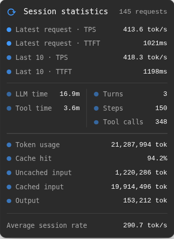
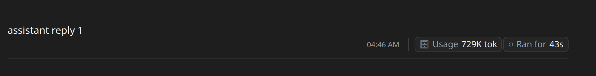
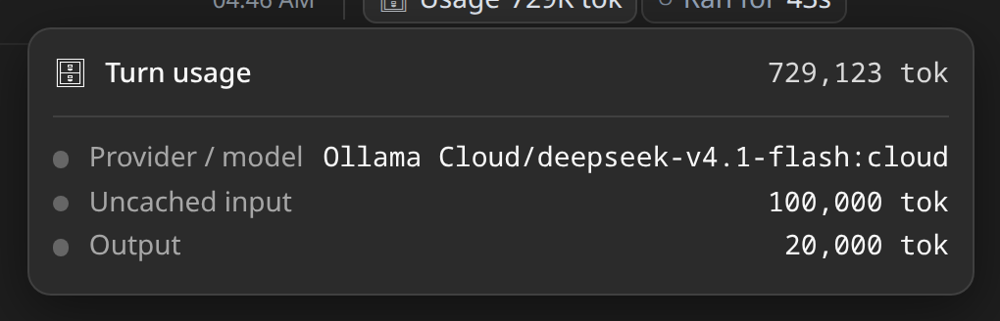
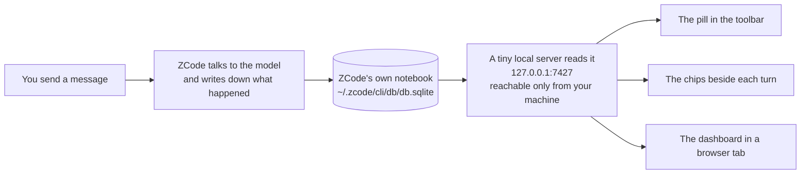
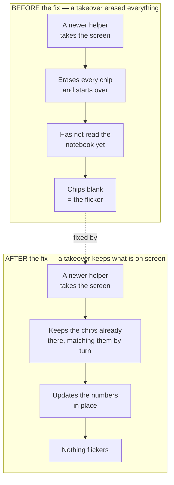

# ViX3L ZCode Tools

[](#license)

A small plugin marketplace for **ZCode Desktop**. It ships two independently installable plugins that surface performance data ZCode already records — without touching model traffic, without telemetry, and without leaving your machine.

| Plugin | What it shows | Version |
|---|---|---|
| **stats-composer** — *Session Statistics (TPS/TTFT)* | Tokens per second and time-to-first-token for every model request: an inline pill in the composer toolbar, plus a local dashboard and CLI. | 0.1.22 |
| **usage-context** — *Turn Usage Context* | Per-turn token usage and elapsed time as chips beside each assistant turn's timestamp, with hover panels for the full breakdown. | 0.1.5 |

Both plugins read the usage database ZCode itself writes (`~/.zcode/cli/db/db.sqlite`), opened **read-only**. Stats therefore work identically across every provider ZCode supports — builtin templates, account plans, and custom OpenAI-compatible endpoints — because nothing is sniffed from the wire.

## What it looks like

The pill, chips, and compact card were captured from a live local ZCode session.
The wide card and usage panel are rendered locally from the shipping page assets.
Every image is a committed asset updated by hand when the UI changes; CI never
generates or rewrites them.

**stats-composer** — the stats pill sits in the composer toolbar, right after the "+" button, and shows the latest request's rate and first-token latency:



Hovering the pill opens the **Session statistics** card: latest request and windowed averages, session time split, turn/step/tool-call counts, the token and cache breakdown, and — when the session started any — a **subagent activity** block: how many ran, what they cost, and what share of the session's tokens they account for. The card ships in a roomy layout by default; a **compact** layout is one setting away (see below):

| Wide (default) | Compact |
|---|---|
|  |  |

**usage-context** — each assistant turn's footer carries two chips beside its timestamp, and hovering either one opens the turn's full accounting:





## How it works, in plain words

**ZCode already writes everything down.** Every time you send a message, ZCode records in its own database how many tokens went in and out, how long until the first token arrived, how fast the rest streamed, and how long the turn took. It does this for itself, whatever provider you use.

**The plugins only read that notebook.** Nothing is sniffed from the network and no model traffic is touched, which is why the figures are identical for a built-in provider, a subscription plan, or a custom endpoint. The database is opened **read-only**.



**Drawing on the screen needs the app's debug door.** The pill and the chips are not part of ZCode — a small helper process draws them by evaluating a script inside the app's own renderer, through its remote-debugging port (CDP). That door is closed unless you launch ZCode with it open, which is why everything else (dashboard, CLI, the appended stats line) exists as a fallback.

**Only one drawing helper may own the screen at a time.** Each helper carries a badge: the script version, a random id for this run, and the sidecar port it reads. A helper whose badge differs takes the screen over — that is how an update or a settings change appears without restarting the app. Three rules make a takeover invisible, and a fourth stops a helper that cannot work from taking the screen at all:



1. A takeover **keeps** the chips that are already on screen and matches them to their turns, instead of erasing everything and starting over.
2. A helper that has not read the notebook yet never blanks a figure that is already showing.
3. A chip disappears only when its turn is really gone from the page — not when one snapshot catches the app mid-re-render without the timestamp row.
4. A helper that cannot reach its own server may not take the screen at all: it stands down rather than owning a display it is unable to fill.

Rule 4 came from a measurement, not a theory. Ten stray helpers — left behind by earlier runs of this repository's own test suite — were alive at once: five pointed at a random port where nothing listens, five at the real one. They took the screen in turns about every 10 seconds, and every takeover blanked the chips, which is exactly what the "shows, goes blank, shows again" flicker was. The test that leaked them now cleans up after itself.

**One asymmetry, stated rather than hidden:** the chips adopt on takeover, but the *pill* still redraws its own small badge when a newer helper takes the composer. Its node is cheap to redraw and that flicker was never reported, so the rule was not applied there; if it ever appears, the same keep-and-update approach is what fixes it.

## Install

1. In ZCode, open **Plugin Marketplace → Add → Add Plugin Marketplace** and paste this repository's URL:
   `https://github.com/ViX3L/vix3l-zcode-tools`
2. Open **Personal → ViX3L ZCode Tools**, pick a plugin, and **Install**:
   - **Session Statistics (TPS/TTFT)** — installed as `stats-composer@vix3l-zcode-tools`
   - **Turn Usage Context** — installed as `usage-context@vix3l-zcode-tools` (requires stats-composer to be enabled; it reads that plugin's local server rather than opening its own)
3. Enable or disable each plugin under **Settings → Plugins**.

Working from a clone instead? Point **Add Plugin Marketplace** at the repository root, or at the clone's `plugins/` folder, which carries its own catalog for the local-directory route.

## After installing

| Command | Does |
|---|---|
| `/stats-composer:tps` | Latest request, windowed average, session average |
| `/stats-composer:dashboard` | Opens the live dashboard (also at `http://127.0.0.1:7427/dashboard`) — model-mix donut, dark/light switch, and a sortable per-request table with an auto-refresh toggle |
| `/stats-composer:doctor` | Health check: Node, DB schema, sidecar, MCP handshake, CDP |
| `/usage-context:usage` | Prints the current session's per-turn figures |

The inline composer pill appears when ZCode exposes a local debugging port — launch once with `zcode --remote-debugging-port=9229`, or use the launcher under `plugins/stats-composer/launcher/`. Without it, the plugins degrade gracefully to the dashboard, the CLI, and an appended stats line; every channel is documented in the plugin skill.

## Settings

Open **Settings → Plugins → (plugin) → Advanced details → Configuration** to change a plugin's options, then click **Save configuration**. The injectors re-read those options on every 10-second sweep, so pill position, card density and chip visibility change without a re-install or an app restart. A sidecar-port change is the one exception: the running server is bound to the old port, so the helper stands down and the next hook starts it on the new one.

| Option | Plugin | Default | Meaning |
|---|---|---|---|
| **Integration mode** | stats-composer | `auto` | `auto` = composer pill when debugging is available, otherwise an appended stats line; `skill` = appended line only; `sidecar` = background server only |
| **Pill position** | stats-composer | `left` | `left` = beside the "+" button; `right` = next to the model selector |
| **Wide session-statistics card** | stats-composer | on | On = the roomier hover card; off = the compact card |
| **Live streaming rate** | stats-composer | on | Interpolate the last completed request's rate while the model is still streaming |
| **Session window size** | stats-composer | `10` | How many recent requests to average |
| **Sidecar port** | stats-composer | `7427` | HTTP port for the local stats server |
| **Show per-turn chips** | usage-context | on | Render the chips at all |
| **Show the "Ran for" chip** | usage-context | on | Also render the elapsed-time chip |
| **stats-composer sidecar port** | usage-context | `7427` | Which stats-composer server to read |

The card layout is also settable by hand: write `{"wideCard": false}` to `~/.zcode/stats-composer/config.json`. The marketplace setting takes precedence when it is set. The same live re-read applies to that file.

## Requirements

- ZCode Desktop.
- Node ≥ 22.5 only if you run the CLI/doctor from a shell. Otherwise no separate Node is needed: hooks and launchers fall back to the Node embedded in ZCode.
- Nothing to configure for data: ZCode creates its usage database the first time you send a message.

## Privacy

Everything runs locally. The stats server binds `127.0.0.1` only, the usage database is opened read-only and never modified, and the plugins make no network requests of their own — no analytics, no accounts, no egress.

## Tests

The suite runs entirely in a container, so nothing has to be installed on your
machine — no Node, no Chromium, no libraries:

```sh
docker compose -f tests/docker/compose.yml run --rm tests
```

That builds the image on first use, runs every tier, and exits with the suite's
status. To run one tier, pass a command (the quoted glob discovers every file in
that tier):

```sh
docker compose -f tests/docker/compose.yml run --rm tests \
  node --test --test-concurrency=1 "tests/ui/**/*.test.mjs"
```

The run uses the image's baked copy of the repository and writes nothing to your
working tree, so no `node_modules` or browser install is needed on the host. To
test an edit, rebuild first (the source `COPY` layer is the only one that
invalidates, so it takes a second or two):

```sh
docker compose -f tests/docker/compose.yml run --rm --build tests
```

That rebuild is not optional: a plain run reuses the image built last time, so it
tests the *previous* checkout — including a checkout from before your test exists.
The counts give it away (a run reporting fewer tests than the tree contains is a
stale image, not a passing suite).

The tiers, and what each one actually proves:

| Tier | What it covers |
|---|---|
| `tests/unit` | Pure logic: the metrics arithmetic against a fixture database, the hook contracts over real processes, the line-delimited JSON-RPC framing the app expects, cross-platform runtime paths, and the release tooling. |
| `tests/integration` | The sidecar's HTTP contract against the real server process and a fixture database: paging, sorting, CORS and method gates, the Prometheus endpoint, the dashboard's HTML. |
| `tests/ui` | The rendered surfaces in a real Chromium: the composer pill and its hover card, the per-turn usage chips and their two hover panels, and the dashboard with its donut geometry and theme toggle. |
| `tests/e2e` | The real injector processes against a real CDP endpoint: target filtering, browser-endpoint attach, attach state, and the two plugins coexisting on one page. |

The UI and E2E tiers do not run a copy of the page scripts.
`tests/lib/extract.mjs` slices the real `PILL_JS_TEMPLATE`, `PAGE_JS`, `CSS` and
card skeleton out of the injectors' source and applies the same placeholder
substitutions the injector applies, so the browser runs what the plugin would
inject. That is what makes a layout assertion a measurement of the shipping code
rather than of a test fixture. The plugins themselves have no runtime
dependencies; the only package here is Playwright, used as a browser driver,
pinned in `package.json`.

## Quality gates

The code-quality contract and its audit baseline are documented in
[`.github/quality/baseline.md`](.github/quality/baseline.md), and enforced by
dependency-free scripts rather than review alone:

```sh
npm run quality        # shared-source sync, clones, dead code, lint rules
npm run quality:score  # the 20-point DRY/clean-code scorecard
```

`quality` fails on a drifted generated copy, a ≥10-line clone, an unused import
or export, an oversized module/function, an empty `catch`, or prefix-based CORS.
`quality:score` turns those results plus structural checks into the scorecard;
CI runs both alongside the container suite.

## Repository layout

```
marketplace.json        ← catalog ZCode reads when this repo is added by URL
assets/                 ← screenshots used by this README
.github/                ← CI and release workflows, release scripts, About copy
plugins/
├── marketplace.json    ← catalog for local-directory installs
├── stats-composer/     ← plugin: per-request TPS/TTFT
└── usage-context/      ← plugin: per-turn usage chips
tests/
├── docker/             ← Dockerfile and compose file for the whole suite
├── lib/                ← extractor, fixtures, sidecar/browser/CDP drivers
├── unit/ integration/ ui/ e2e/
└── README.md           ← how the harness works, tier by tier
```

## Releases

Releases are cut by pushing a version tag; `.github/workflows/release.yml` runs
the whole suite first, then publishes a GitHub Release per plugin with its source
tree as a `.zip`, a `.tar.gz`, and a `.sha256` checksums file. Use `v0.1.22` to
release every plugin, or `stats-composer-v0.1.22` / `usage-context-v0.1.5` for
one. A tag's version must match the plugin's own manifest — a mismatch fails the
run before anything is published.

Each Release's notes are the plugin's changelog section for that version — what
actually changed, not a redirect to the commit list:
[stats-composer](plugins/stats-composer/CHANGELOG.md) ·
[usage-context](plugins/usage-context/CHANGELOG.md). The tag convention, the
worked example and the repository About copy are in
[`.github/ABOUT.md`](.github/ABOUT.md).

Installing from ZCode does **not** go through a Release: the marketplace reads
[`marketplace.json`](marketplace.json) on `main`, so a version bump reaches you
as soon as it is pushed. Releases are the record of each version, and where the
downloadable archives live.

## Developed by

[ViX3L](https://github.com/ViX3L). Issues and pull requests are welcome at [ViX3L/vix3l-zcode-tools](https://github.com/ViX3L/vix3l-zcode-tools).

## License

MIT — see [LICENSE](LICENSE). Also declared in each plugin's `plugin.json`.
